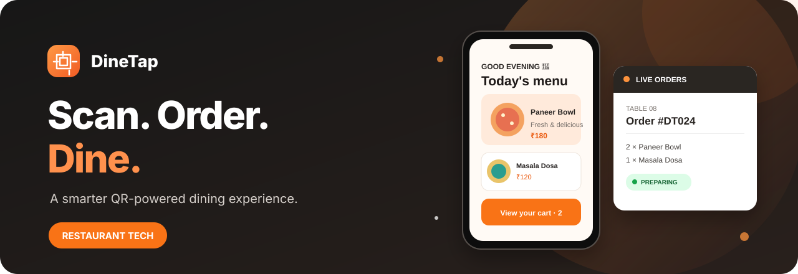

<p align="center">
  
</p>

<h1 align="center">🍽️ DineTap</h1>

<p align="center">
  <strong>Scan. Order. Dine.</strong><br/>
  A smarter QR-based ordering experience for modern restaurants.
</p>

<p align="center">
  
  
  
  
</p>

DineTap makes dine-in simpler. Guests scan a table QR code to explore the menu and build an order, while restaurant teams get a clearer way to manage service from one workspace.

## ✨ What’s inside

- 📱 **QR-first menu** — a mobile-friendly digital menu for each table.
- 🛒 **Easy ordering** — browse categories, add dishes, and manage cart quantities.
- 🧑‍🍳 **Restaurant operations** — a dashboard concept for orders, tables, and kitchen workflows.
- 📊 **Business insights** — a foundation for sales and menu analytics.
- 💳 **Payments & split bills** — planned checkout capabilities.

## 🖥️ Demo pages

| Page | Route |
| --- | --- |
| Product landing page | `/` |
| Interactive customer menu | `/menu/demo` |
| Restaurant dashboard preview | `/dashboard` |

> **Current status:** The landing page, interactive sample menu/cart, and dashboard preview are in place. Demo data is local/static; authentication, database persistence, live order updates, and payment processing are not implemented yet.

## 🧰 Tech stack

**Next.js · React · TypeScript · Tailwind CSS · Lucide Icons**

Planned next: PostgreSQL + Prisma, authentication, real-time order updates, and Razorpay integration.

## 🚀 Run locally

**Requirements:** Node.js and npm.

```bash
git clone https://github.com/samihan45/Quick-Dine.git
cd Quick-Dine
npm install
npm run dev
```

Open [http://localhost:3000](http://localhost:3000).

## 📁 Project structure

```text
src/
├── app/          # Pages and routes
├── components/   # Reusable UI
├── lib/          # Shared utilities
├── modules/      # Business features
├── store/        # Client state
└── types/        # TypeScript types
docs/             # Project documentation
public/images/    # README visuals
```

## 🗺️ Roadmap

- [x] Landing page and visual foundation
- [x] Demo menu and cart interactions
- [x] Restaurant dashboard preview
- [ ] PostgreSQL database and Prisma
- [ ] Authentication and restaurant onboarding
- [ ] Menu, table, and QR management
- [ ] Persistent orders and kitchen display
- [ ] Real-time updates and payment integration
- [ ] Testing, CI/CD, and deployment

## 🤝 Contributing

Ideas and improvements are welcome. Open an issue to discuss a change, or submit a pull request with a clear description.

---

<p align="center">
  Built with ❤️ for better dining experiences.
</p>
